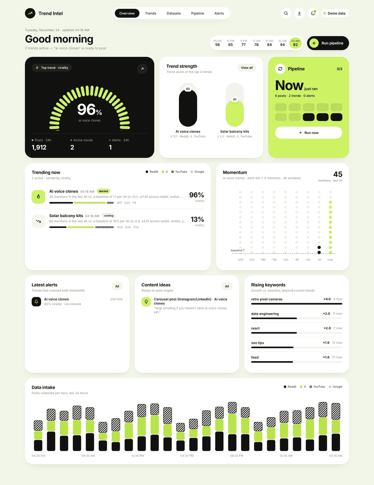
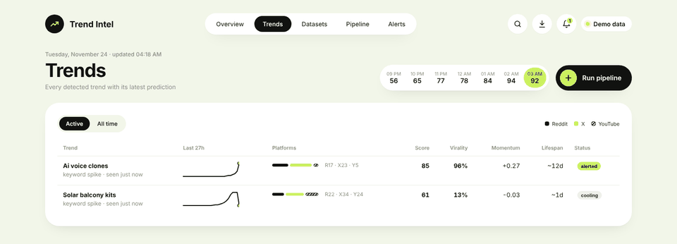
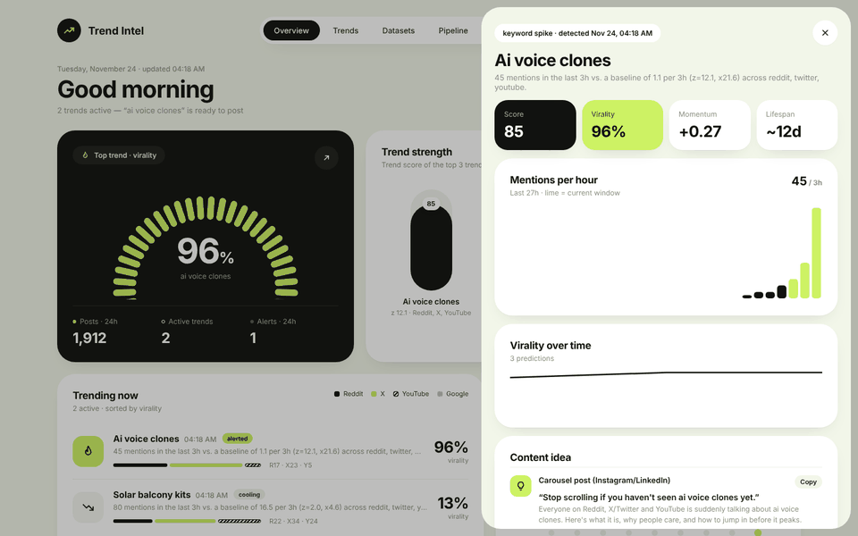
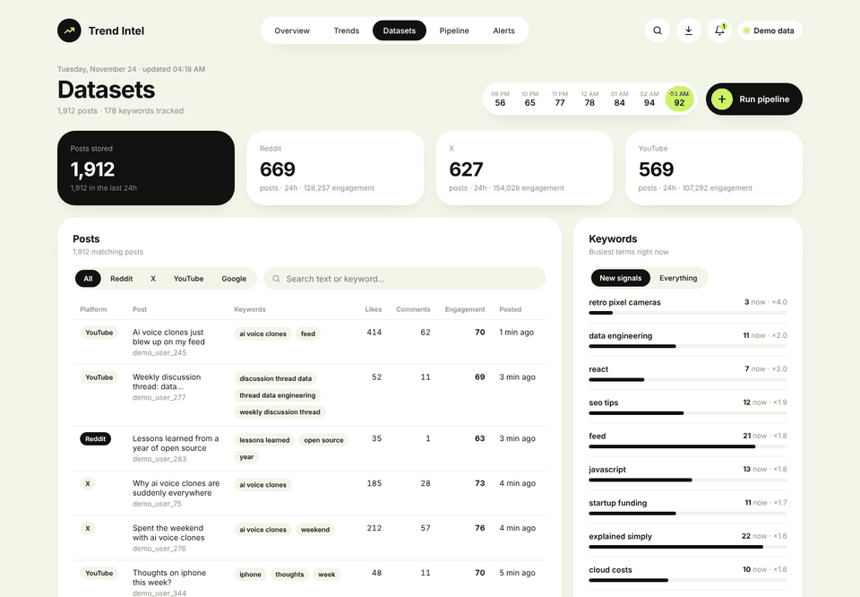
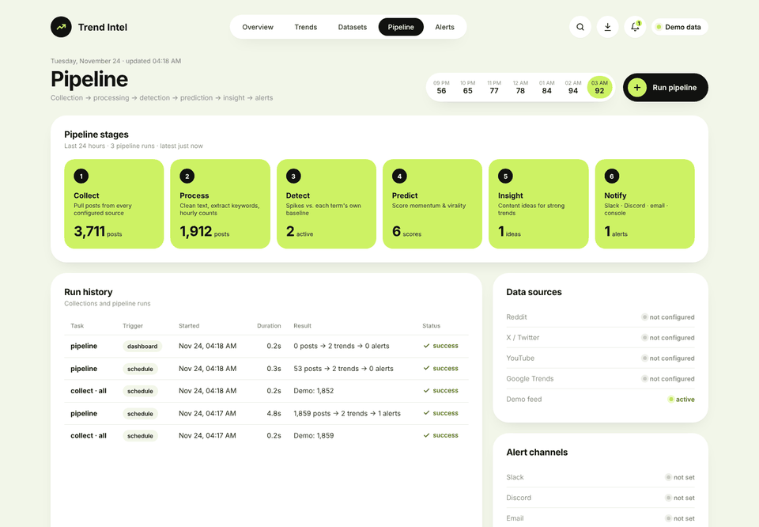
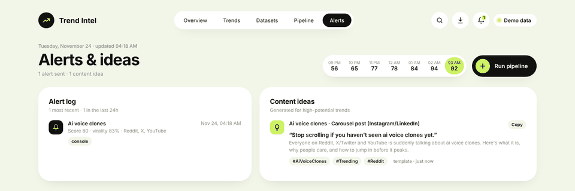
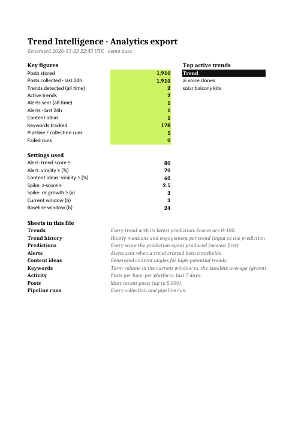

# Dashboard & analytics guide

This is a complete tour of the web dashboard (http://localhost:8000) and the analytics export. For each widget
it covers **what you see**, **where the number comes from** and **how to use it**.

* Front end: `web/index.html` (one file, no build step) · Back end: `api/server.py` (FastAPI) ·
  Export: `analytics/export.py`
* Data refreshes every **30 seconds** (paused while a trend detail panel is open or the tab is hidden).
* Times are shown in your browser's time zone; the database and the export use **UTC**.
* Screenshots below use demo data.

**Contents:** [Top bar](#top-bar) · [Overview](#1-overview) · [Trends](#2-trends) ·
[Trend detail](#3-trend-detail-panel) · [Datasets](#4-datasets) · [Pipeline](#5-pipeline) ·
[Alerts & ideas](#6-alerts--ideas) · [Analytics export](#7-analytics-export-one-combined-file) ·
[Every metric in one table](#8-every-metric-in-one-table) · [API map](#9-which-api-feeds-which-widget)

---

## Top bar

| Element | What it does |
|---|---|
| **Trend Intel** logo | back to Overview |
| **Overview · Trends · Datasets · Pipeline · Alerts** | the five pages (URL hash routing: `#overview`, `#trends`, …) |
| 🔍 Search | jumps to Datasets with the search box focused |
| ⬇ Download | downloads the **analytics workbook** (`/api/export.xlsx`, see §7) |
| 🔔 Bell + lime badge | alerts in the last 24h; opens the Alerts page |
| Status chip | **Demo data** (orange dot) = synthetic feed; **Live sources** (green) = real APIs; **Offline** (grey) = the API can't reach the database |
| Hour strip | posts collected in each of the last 7 hours; the current hour is highlighted lime |
| **Run pipeline** | collects from every source, then runs the whole pipeline now (`POST /api/run`). It shows *Running…* and a toast when done. Only one run at a time; a second click says *already in progress*. |
| Greeting + subtitle | page title; on Overview, how many trends are active and which one is ready to post |

---

## 1. Overview

### 1.1 Top trend · virality (black card)
* **Gauge:** 28 segments; the lit share = the **virality probability** of the highest-ranked active trend.
  The big number is that percentage, and the trend name sits under it.
* **↗ button:** opens that trend's detail panel.
* **Posts · 24h:** posts collected in the last 24 hours (`posts.collected_at`).
* **Active trends:** trends with `is_active = true` (seen in the last 48h).
* **Alerts · 24h:** alerts sent in the last 24 hours.
* *Use it:* the one-glance answer to "is there something worth posting about right now?"

### 1.2 Trend strength (white card)
* Pill bars for the **top 3 trends** (black, lime, hatched). Bar height and badge = **trend score (0–100)**.
* Under each bar: the spike **z-score** and the platforms it's on.
* *Use it:* compare how strong the leading trends are *now*. Score ≥ 80 is alert territory.

### 1.3 Pipeline (lime card)
* **Big number:** time since the latest pipeline run (*Now* = under a minute).
* **Line under it:** that run's result (posts processed · trends detected · alerts sent).
* **10 blocks:** the last 10 pipeline runs, oldest → newest. Black = success, red = failed, hatched = running,
  faded = no run yet. **x/10** in the corner = successful runs.
* **Run now:** same as the top-bar button.

### 1.4 Trending now
For up to 5 active trends, sorted by virality:
* **Icon tile:** 🔥 lime = virality at or above the alert threshold; ↗ = rising; ↘ = cooling (negative momentum);
  🔍 = a Google Trends search.
* **Name · time detected · tags:** `alerted` (an alert was sent), `cooling` (momentum < 0).
* **Grey line:** the detection signal, e.g. *"45 mentions in the last 3h vs. a baseline of 1.1 per 3h (z=12.1,
  x21.6) across reddit, twitter, youtube"*.
* **Split bar:** mentions in the last 3h by platform (black = Reddit, lime = X, hatched = YouTube, grey =
  Google), with counts (`R17 · X23 · Y5`).
* **Big %:** virality probability.
* Click a row to open its detail panel.

### 1.5 Momentum (dot matrix)
* The top trend's mentions in **3-hour windows** over the last 27h (columns `-24h … now`).
* Each dot ≈ *N* mentions (shown in the subtitle). Black = history, **lime = current window**.
* Dashed line = the **baseline** (average of the earlier windows).
* Top right = mentions in the last 3 hours.
* *Use it:* a column far above the dashed line is exactly what the detector calls a spike.

### 1.6 Latest alerts · Content ideas · Rising keywords
* **Latest alerts:** last 4 alerts, with virality at alert time and the channels used.
* **Content ideas:** latest 3 ideas (format · trend · hook).
* **Rising keywords:** terms growing fastest vs. their baseline (**×growth** and the current count), leaving out
  words that are already part of an active trend, generic words and duplicate fragments. *Use it:* an early
  warning list. These terms are moving but aren't trends yet.

### 1.7 Data intake
Stacked bars: posts per hour per platform for the last 24h. Gaps mean a source isn't collecting; check
**Pipeline → Data sources**.

---

## 2. Trends

| Column | Meaning |
|---|---|
| Trend | name · source (`keyword spike`, `google trends`, `topic cluster`) · when last seen |
| Last 27h | sparkline of hourly mentions; the lime dot is the latest hour |
| Platforms | split bar of mentions in the last 3h |
| Score | trend score 0–100 (strength now) |
| Virality | virality probability 0–100% |
| Momentum | hourly log-growth over the last 6h (+0.30 ≈ 35% more mentions per hour) |
| Lifespan | estimated days the trend stays relevant |
| Status | `alerted` · `watching` (active, not alerted) · `cooling` (momentum < 0) · `inactive` |

* **Active / All time** toggle: include trends not seen for 48h.
* Click any row for the detail panel.

---

## 3. Trend detail panel

* **Header:** source and detection time, name, detection signal.
* **Score · Virality · Momentum · Lifespan** tiles: the latest prediction.
* **Mentions per hour:** the last 27 hourly buckets (lime = current 3h window). Hover for exact counts.
* **Virality over time:** one point per prediction (each pipeline run), showing whether the trend is heating up
  or cooling.
* **Content idea:** format, hook, caption and hashtags, with a **Copy** button (hook + caption + hashtags).
* **Top posts:** the most engaging related posts, linked to the original.
* **Alerts:** when it was alerted and through which channels.
* Close with ✕, Esc, or by clicking outside.

---

## 4. Datasets

* **Stat cards:** total posts stored, then posts in the last 24h per platform with their total engagement
  (likes + 2·comments + 3·shares).
* **Posts table:** platform, text (linked to the source), author, the 3 **most specific keywords** extracted,
  likes, comments, **engagement score** (0–100, log-scaled engagement per view), and age.
  * Platform filter (*All · Reddit · X · YouTube · Google*).
  * **Search** matches post text *or* an exact extracted keyword (300 ms debounce).
  * Paging: 15 per page.
* **Keywords panel:** busiest terms in the current window with the current count and ×growth.
  * **New signals** hides terms that belong to an active trend; **Everything** shows all.
  * Click a keyword to search posts containing it.

---

## 5. Pipeline

* **Pipeline stages** (last 24 hours): one tile per stage. Lime = it did work in that period.

  | Stage | Number shown |
  |---|---|
  | 1 Collect | posts collected across all collection runs |
  | 2 Process | posts processed (cleaned, keywords extracted) |
  | 3 Detect | trends currently active |
  | 4 Predict | predictions made |
  | 5 Insight | content ideas generated |
  | 6 Notify | alerts sent |

* **Run history:** every collection (`collect · all`) and pipeline run, with trigger (`schedule`, `manual` from the
  CLI, `dashboard`), start time, duration, result and status. Hover a failed status to see the error.
* **Data sources:** which sources are active (based on `.env` and demo mode).
* **Alert channels:** Slack, Discord, email and OpenAI, connected or not.
* **Schedule & thresholds:** each scheduled job's interval, the alert rule (score ≥ 80 · virality ≥ 70%), the spike
  rule (z ≥ 2.5 or ×3) and the windows (3h vs. 24h). These come from `config/config.yaml`.

---

## 6. Alerts & ideas

* **Alert log:** every alert, newest first: trend, score and virality **at the time of the alert**, platforms,
  channel chips and timestamp. Click to open the trend.
* **Content ideas:** every generated idea: trend · format, hook (bold), caption, hashtags, the generator (`template`
  or the OpenAI model name), age, and **Copy**.

---

## 7. Analytics export: one combined file

Download it from the **⬇** icon in the top bar, `GET /api/export.xlsx`, or the CLI (`python main.py export
[path]`). It produces **`trend-analytics-YYYYMMDD-HHMM.xlsx`**, containing all the analytics at that moment.

| Sheet | Contents | Columns (main) |
|---|---|---|
| **Summary** | key figures, the settings used, a sheet index, the **top active trends** table and a bar chart (virality vs. trend score) | — |
| **Trends** | every trend + latest prediction | trend, source, platforms, active, trend score, virality %, momentum, lifespan, spike z, alerts, ideas, detected / last seen / last scored (UTC), model, signal |
| **Trend history** | hourly series per trend (the model's input) | trend, hour, mentions, engagement, growth vs. previous hour |
| **Predictions** | every prediction ever made | trend, scored at, trend score, virality %, momentum, lifespan, model |
| **Alerts** | alert log with scores at alert time | sent at, trend, score at alert, virality at alert, channels, platforms, type |
| **Content ideas** | all ideas | generated, trend, format, hook, caption, hashtags, generator |
| **Keywords** | up to 2,000 terms: current window vs. baseline | term, current, baseline total, growth ×, platforms, lifetime mentions, first / last seen |
| **Activity** | posts per hour per platform for the last 7 days, plus a stacked column chart | hour, reddit, X, YouTube, Google Trends, total |
| **Posts** | the 5,000 most recent posts | id, platform, posted, author, text, likes, comments, shares, views, engagement score, keywords, URL, collected |
| **Pipeline runs** | every run | started, task, trigger, status, duration, result (JSON), error |

Every table has a dark header row, frozen headers, filters and sensible number formats. To use it in Excel or
Google Sheets, filter **Trends** by `Active = TRUE`, sort by *Virality %*, and pivot **Trend history** to
chart any trend's curve.

---

## 8. Every metric in one table

| Metric | Range | Definition | Where you see it |
|---|---|---|---|
| Mentions | count | posts in an hour (or window) containing the phrase | detail chart, momentum dots, split bars |
| Spike z-score | any | (current 3h − baseline mean) / (baseline std + 1) | Trend strength, signal line, export |
| Growth ratio (×) | ≥ 0 | (current 3h + 1) / (baseline 3h mean + 1) | signal line, keywords |
| Trend score | 0–100 | 35% growth + 25% volume + 25% novelty + 15% cross-platform reach | bars, tables, tiles |
| Virality probability | 0–100% | logistic of momentum, acceleration, volume, spread, novelty | gauge, lists, tables |
| Momentum | any | slope of ln(1 + mentions) over the last 6h | Trends table, detail |
| Lifespan | 1–14 days | from momentum, spread and acceleration | Trends table, detail, alerts |
| Engagement score | 0–100 | 10·ln(1 + (likes + 2c + 3s)/views·10⁴) (or without views) | Datasets |
| Alert rule | — | trend score ≥ 80 **and** virality ≥ 70%, 24h cooldown | Pipeline page |
| Idea rule | — | virality ≥ 60%, at most one idea per trend per 24h | — |

The full derivations are in [LEARNING_GUIDE.md §5](LEARNING_GUIDE.md#5-end-to-end-what-happens-in-one-run).

---

## 9. Which API feeds which widget

| Widget | Endpoint |
|---|---|
| Status chip, KPIs, badge, greeting, thresholds | `GET /api/overview` |
| Gauge, Trend strength, Trending now, Momentum, Trends page | `GET /api/trends` |
| Detail panel | `GET /api/trends/{id}` |
| Hour strip, Data intake | `GET /api/activity` |
| Pipeline card, Pipeline page | `GET /api/runs`, `GET /api/config` |
| Latest alerts, Alert log | `GET /api/alerts` |
| Content ideas | `GET /api/ideas` |
| Rising keywords, Keywords panel | `GET /api/keywords` |
| Posts table | `GET /api/posts` |
| Run pipeline | `POST /api/run`, then poll `GET /api/run` |
| ⬇ Download | `GET /api/export.xlsx` |

Try them all at **http://localhost:8000/docs**.
