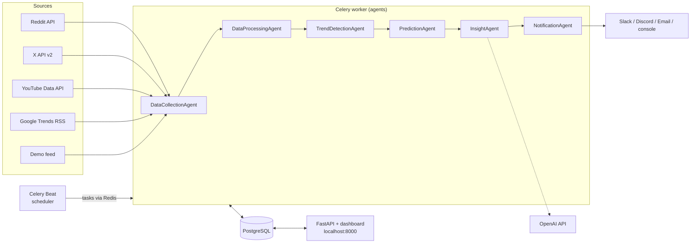
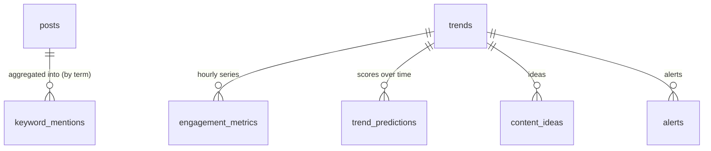

# Learning guide: how Trend Intelligence works, end to end

This guide is for **understanding the project deeply and explaining it in interviews**. It goes from the
one-minute pitch, through every technology and data source, to each step of a pipeline run with the real
formulas. It ends with the design decisions, the bugs that were fixed, and practice questions.

Read it alongside the code: every section names the file to open.

**Contents**
1. [The pitch](#1-the-pitch)
2. [Architecture in one picture](#2-architecture-in-one-picture)
3. [Technology stack: what, why, where, what to learn](#3-technology-stack)
4. [How data is fetched: each source](#4-how-data-is-fetched)
5. [End to end: what happens in one run](#5-end-to-end-what-happens-in-one-run)
6. [The data model](#6-the-data-model)
7. [Scheduling and orchestration](#7-scheduling-and-orchestration)
8. [The dashboard and API](#8-the-dashboard-and-api)
9. [Testing, CI and quality](#9-testing-ci-and-quality)
10. [Design decisions and trade-offs](#10-design-decisions-and-trade-offs)
11. [Bugs found and fixed (interview stories)](#11-bugs-found-and-fixed)
12. [Interview questions with answers](#12-interview-questions-with-answers)
13. [Glossary](#13-glossary)
14. [A 2-week learning plan](#14-a-two-week-learning-plan)

---

## 1. The pitch

**30 seconds:** *"Trend Intelligence watches Reddit, X, YouTube and Google Trends, and spots topics that are
starting to take off before they peak. It compares how much each phrase is being talked about now with its own
normal level, scores each trend's momentum and chance of going viral, writes a content idea for the strong ones,
and sends an alert to Slack, Discord or email. It runs on a schedule with Celery and Postgres, and has a web
dashboard."*

**2 minutes (add these):**
* It's a **multi-agent pipeline**: collect → process → detect → predict → generate insight → notify. Each agent
  is a small class that reads from and writes to PostgreSQL, so stages are decoupled and can be re-run.
* Detection is **statistical, not keyword lists**. Every phrase gets an hourly time series. A trend is a phrase
  whose last 3 hours are unusual compared with its own previous 24 hours (z-score or growth ratio).
* Prediction uses **transparent features** (momentum, acceleration, volume, cross-platform spread, novelty)
  combined into a 0–100 trend score and a logistic virality probability. Prophet is blended in when installed.
* It is **production-shaped**: idempotent schema migrations, upserts, run logging, Docker Compose, CI with a
  real Postgres, 38 tests, and a demo data mode so it runs with zero API keys.

---

## 2. Architecture in one picture



**Processes (Docker Compose services):** `db` (Postgres 16), `redis` (Redis 7, the message broker), `migrate`
(applies the schema once, then exits), `worker` (Celery worker that runs the agents), `scheduler` (Celery Beat,
which decides *when*), and `web` (FastAPI serving the API and dashboard).

**Folder map**

| Folder | What lives there |
|---|---|
| `services/` | One client per data source; each returns a list of normalised post dicts |
| `agents/` | The six pipeline stages |
| `data_processing/` | Text cleaning and keyword / phrase extraction |
| `ai_models/` | Spike detection (`trend_model.py`) and scoring (`prediction_model.py`) |
| `alerts/` | Slack, Discord and email senders |
| `workflows/` | Celery app, beat schedule, `run_pipeline()`, run logging, APScheduler alternative |
| `database/` | Engine/connection and the idempotent `schema.sql` |
| `api/` + `web/` | FastAPI server and the single-file dashboard |
| `analytics/` | The Excel export |
| `config/` | `config.yaml` + loader (merges defaults, reads `.env`) |
| `tests/` | Unit tests and Postgres integration tests |

---

## 3. Technology stack

For each technology: **what it is**, **why it's used here**, **where to look**, and **what to learn**.

### Python 3.11+
* **Why:** the best ecosystem for data, NLP and ML, plus solid web and queue libraries.
* **Learn:** type hints, context managers (`with`, `@contextmanager` in `workflows/pipeline.py`), generators,
  `functools.lru_cache` (config caching), `dataclasses` vs dicts, `logging`, virtual environments.

### PostgreSQL 16 (database)
* **What:** a relational database.
* **Why:** the data is relational (posts → keywords → trends → predictions → alerts), and we need upserts,
  arrays, JSON, window/time functions and transactions.
* **Features this project uses (good interview material):**
  * `INSERT … ON CONFLICT … DO UPDATE` (**upsert**) makes collection idempotent: re-collecting a post
    updates its likes instead of duplicating it.
  * `TEXT[]` arrays with a **GIN index** (`posts.keywords`) support fast queries like "posts containing phrase X"
    (`keywords @> ARRAY['ai voice clones']`).
  * `generate_series` builds zero-filled hourly series (hours with no mentions still appear as 0).
  * `date_trunc('hour', …)` buckets data by hour.
  * `DISTINCT ON` powers the `latest_trend_predictions` view (newest prediction per trend).
  * `FOR UPDATE SKIP LOCKED` lets two workers process posts in parallel without taking the same rows.
  * `JSONB` stores each run's summary in `pipeline_runs`.
  * Partial index: `WHERE processed = FALSE` makes "find unprocessed posts" cheap.
* **Where:** `database/schema.sql`, the SQL inside every agent.
* **Learn:** indexes (B-tree vs. GIN), transactions and isolation, upserts, `EXPLAIN ANALYZE`, normalisation
  vs. arrays.

### SQLAlchemy 2 + psycopg2 (database access)
* **What:** SQLAlchemy is a Python SQL toolkit (Core + ORM); psycopg2 is the Postgres driver underneath.
* **How it's used:** **SQLAlchemy Core with raw `text()` SQL**, not the ORM, because the queries are analytical
  (CTEs, arrays, `FILTER`) and clearer as SQL. `engine.begin()` gives a transaction that commits on success and
  rolls back on error. The connection pool has `pool_pre_ping=True` to survive database restarts.
* **Gotcha fixed:** SQLAlchemy 2.1 changed the default driver for `postgresql://` URLs to psycopg 3, so
  `database/db_connection.py::normalize_url` pins `postgresql+psycopg2://`. The session time zone is pinned to
  UTC so hourly buckets are consistent.
* **Learn:** engine vs. connection vs. session, connection pooling, bound parameters (`:name`, which prevent
  SQL injection), transactions.

### Redis 7 (message broker)
* **What:** an in-memory data store.
* **Why:** Celery needs a broker to pass task messages from Beat (and from anyone calling `.delay()`) to workers.
  It also stores task results here.
* **Learn:** what a message broker is, at-least-once delivery, why Redis is fast (in memory, single-threaded
  event loop).

### Celery 5 (task queue) + Celery Beat (scheduler)
* **What:** Celery runs Python functions ("tasks") asynchronously in worker processes. Beat is a scheduler
  process that enqueues tasks on a timetable.
* **Why:** collection and the pipeline must run periodically, independently of the web server, and can scale
  out to more workers.
* **Where:** `workflows/pipeline.py`. Tasks include `run_core_pipeline`, `run_demo_collection` and
  `run_reddit_collection`. `schedule_plan()` decides which jobs exist: a source is only scheduled if its key is
  configured. Schedules are `timedelta` intervals (a `crontab(minute="*/60")` is invalid, which was one of the
  original bugs).
* **Learn:** producer / broker / worker / result-backend roles, `delay()` vs. `apply_async()`, retries, idempotent
  tasks, concurrency (prefork), why long tasks need visibility timeouts.

### APScheduler (alternative scheduler)
* **Why:** `python main.py schedule` runs the same jobs **without Redis or Celery**, which is handy for local runs.
  Same `schedule_plan()`, different runner (`workflows/scheduler.py`).

### spaCy (NLP)
* **What:** an industrial NLP library; `en_core_web_sm` is a small English model (tokeniser, POS tagger, parser).
* **How it's used:** single words are kept if spaCy tags them as nouns, proper nouns or adjectives. Phrases come
  from **2–3-word n-grams inside runs of non-stop-words**. Why not spaCy's noun chunks? The small model often
  mis-tags lowercase social text (for example "ai" as a verb), which split one trend into many phrases.
* **Where:** `data_processing/keyword_extraction.py`. There is a fallback without spaCy, using a stop-word list.
* **Learn:** tokenisation, stop words, POS tagging, n-grams, why small models struggle on informal text.

### NumPy (numerics)
* **Used for:** fitting slopes (`np.polyfit`) to the log of the mention series in the prediction model.

### Prophet (optional forecasting)
* **What:** Meta's time-series forecasting library (additive model: trend + seasonality).
* **How it's used:** if installed and the trend has ≥12 hours of history, it forecasts the next 24h of
  mentions. The expected growth is blended into momentum. Optional because it is heavy (`requirements-ml.txt`).

### BERTopic (optional topic clustering)
* **What:** topic modelling with transformer embeddings + clustering.
* **How it's used:** off by default (`detection.topic_clustering: true` turns it on); it groups recent posts into
  topics that become trends.

### OpenAI API (content ideas)
* **How it's used:** `agents/insight_agent.py` sends the trend name, its signal and up to 5 top posts. It asks
  for JSON (`response_format={"type": "json_object"}`) with format, hook, caption and hashtags. The model is
  configurable (`OPENAI_MODEL`, default `gpt-4o-mini`). With no key, or if the call fails, a **template
  generator** is used, so the pipeline never breaks.
* **Learn:** prompt design, JSON mode / structured output, graceful degradation, cost control (only strong
  trends, at most once per 24h).

### FastAPI + Uvicorn (web API)
* **What:** FastAPI is a modern Python web framework (type hints → validation + automatic OpenAPI docs at
  `/docs`). Uvicorn is the ASGI server that runs it.
* **Where:** `api/server.py`. It has read-only JSON endpoints, `POST /api/run` (starts a background thread,
  guarded by a lock so only one run happens at a time), and `GET /api/export.xlsx`.
* **Learn:** path/query parameters, Pydantic models, dependency injection, exception handlers (a database outage
  returns a clean 503), sync vs. async endpoints.

### Front end: HTML + CSS + vanilla JavaScript + SVG
* **Why no React:** one static file (`web/index.html`) with no build step is easy to ship inside the Python
  container. Charts (gauge, pill bars, dot matrix, sparklines, stacked bars) are hand-drawn **SVG**.
* **Learn:** `fetch` + `async/await`, hash-based routing (`#overview`, `#trends`, …), CSS grid, CSS variables,
  responsive media queries, escaping HTML to prevent XSS (`esc()`).

### openpyxl (Excel export)
* Builds the multi-sheet analytics workbook with native Excel charts (`analytics/export.py`).

### Docker + Docker Compose
* **What:** Docker packages the app and its dependencies into an image. Compose runs several containers
  together.
* **Highlights:** one image is used by four services, each with a different `command`. A YAML anchor (`x-app`)
  avoids repetition. The `migrate` service must **complete successfully** before the worker, scheduler and web
  start. Health checks gate startup on Postgres and Redis being ready. The container runs as a non-root user.
* **Learn:** image vs. container, layers and caching (copy `requirements.txt` first), volumes (data persistence
  in `db_data`), bind mounts (`./config`), networking (containers reach each other by service name, e.g. `db`).

### GitHub Actions (CI)
* `.github/workflows/ci.yml` runs flake8 lint and pytest against a **real Postgres service container**, then
  builds the Docker image, on every push.

### pytest + flake8
* 38 tests: unit tests (models, text, demo, agents' logic) and integration tests (full pipeline, API, export) on
  Postgres.

---

## 4. How data is fetched

Every source returns the **same normalised post dict**, which is why the rest of the pipeline doesn't care where
data came from:

```python
{"platform": "reddit", "post_id": "abc123", "author": "...", "title": "...", "body": "...", "url": "...",
 "posted_at": 1732400000.0,   # unix timestamp
 "likes": 120, "comments": 14, "shares": 0, "views": 0, "hashtags": ["..."]}
```

`DataCollectionAgent._store()` writes them with a single batched **upsert** keyed on `(platform, post_id)`.

### Reddit (`services/reddit_api.py`)
* **Library:** PRAW (Python Reddit API Wrapper), read-only mode.
* **Auth:** OAuth "script" app credentials (`REDDIT_CLIENT_ID`, `REDDIT_CLIENT_SECRET`) and a descriptive
  `REDDIT_USER_AGENT`. Reddit requires a unique user agent.
* **Call:** `reddit.subreddit(name).top(time_filter="day", limit=25)` for each subreddit in `config.yaml`.
* **Mapping:** score → likes, `num_comments` → comments, `created_utc` → posted_at. Reddit doesn't expose
  shares, and views are mostly null.
* **Limits:** about 100 requests/minute per OAuth client; PRAW handles rate limiting.

### X / Twitter (`services/twitter_api.py`)
* **Library:** Tweepy `Client` (API v2).
* **Auth:** app-only **Bearer token**.
* **Call:** `search_recent_tweets(query="<keyword> -is:retweet lang:en", max_results=10..100,
  tweet_fields=[created_at, public_metrics, entities, …])`. Search covers the last 7 days. The query operators
  drop retweets (duplicates) and non-English posts.
* **Mapping:** `public_metrics` → like/reply/retweet/impression counts; hashtags come from `entities`.
* **Limits:** recent search needs a paid tier; `max_results` must be 10–100 (clamped in code).

### YouTube (`services/youtube_api.py`)
* **Library:** `google-api-python-client` (`build("youtube", "v3", developerKey=…)`).
* **Auth:** an API key from Google Cloud with **YouTube Data API v3** enabled.
* **Call:** `videos().list(part="snippet,contentDetails,statistics", chart="mostPopular", regionCode="US",
  maxResults≤50)` returns the trending chart.
* **Mapping:** view/like/comment counts from `statistics`; tags → hashtags; `publishedAt` (ISO 8601) →
  timestamp.
* **Quota:** 10,000 units/day by default; `videos.list` costs 1 unit, so every 30 minutes is very cheap.
* **Subtlety:** trending videos are often days old, so a video older than 48h when first seen is counted at the
  time it was *observed*, not when it was published (see step 2 below).

### Google Trends (`services/google_trends_api.py`)
* **No key.** Uses the public **"Trending now" RSS feed**: `https://trends.google.com/trending/rss?geo=US`.
* **Parsing:** `xml.etree.ElementTree` with the `ht:` namespace (`https://trends.google.com/trending/rss`) reads
  `title`, `ht:approx_traffic` (e.g. "20K+" → 20000) and the related news headlines.
* **Fallback:** `pytrends` (unofficial; Google retired the endpoint its `trending_searches` used, and the library
  is unmaintained), so it's only tried if the RSS feed fails.
* Each search becomes a post with `platform="google_trends"` and also becomes a trend directly.

### Demo feed (`services/demo_source.py`)
* Generates realistic posts with **no network**. Each hour's posts are produced by a random generator *seeded
  with that hour*, so they are **deterministic**: re-collecting the same hour produces the same post IDs, and
  the upsert makes it idempotent.
* There are 16 steady background topics plus 2 "emerging topic" slots on 12-hour cycles, offset by 6 hours.
  Emerging volume grows about 1.55× per hour and spreads from Reddit to X to YouTube, so the detector always
  has something rising, peaking or fading.
* Used automatically when `DEMO_MODE=auto` and no source key is set.

### Credentials handling
`config.env()` treats placeholder values like `your_reddit_client_id` (copied from `.env.example`) as **not
set**. Otherwise a placeholder would make a client "initialise" and then fail on every call.

---

## 5. End to end: what happens in one run

Entry points: Celery task `run_core_pipeline`, `python main.py run-once`, or the dashboard's **Run pipeline**.
Each run is wrapped in `recorded_run()`, which inserts a `pipeline_runs` row (`status='running'`) and then marks
it `success` or `failed` with a JSON summary and duration.

### Step 1: Collect (`agents/data_collection_agent.py`)
1. `collect_all()` checks `config.demo_mode_enabled()`. In demo mode it collects demo posts only. Otherwise it
   calls each source; a failure in one source is logged and doesn't stop the others.
2. API clients are **created lazily**, so a missing library or key only disables that source.
3. Posts are normalised (`_params`: hashtags lower-cased without `#`, authors truncated, numbers defaulted)
   and **batch-upserted**.

### Step 2: Process (`agents/data_processing_agent.py`)
Processes unprocessed posts in batches of 500 (`FOR UPDATE SKIP LOCKED`, up to 20 batches per run). For each
post:

1. **Clean** (`clean_text`): HTML-unescape, lowercase, remove URLs and @mentions, keep letters, digits and
   `#`.
2. **Extract terms** (`post_terms`): spaCy nouns/proper nouns/adjectives, plus 2–3-word n-grams, plus hashtags.
   For Google Trends posts, the whole search query is also a term.
3. **Engagement:** `raw = likes + 2·comments + 3·shares`.
   *Engagement score (0–100)* = `10·ln(1 + raw/views·10000)` if views are known, else `10·ln(1 + raw)`,
   capped at 100.
4. **Mention hour:** normally the hour the post was published. If the post was already **more than 48h old when
   first seen**, it counts in the hour it was collected. (This cut-off must be outside the 27h detection window;
   see bug #6.)
5. Aggregate in memory, then **bulk upsert** into `keyword_mentions (word, hour, platform) += mentions,
   engagement`. Update lifetime `keywords` totals and mark the posts `processed`, storing their `keywords`
   array.

Result: an **hourly time series for every term on every platform**. This is the core data structure.

### Step 3: Detect (`agents/trend_detection_agent.py` + `ai_models/trend_model.py`)
1. **Candidates:** terms with ≥ `min_mentions` (5) in the *current window* (last 3 hourly buckets). For each,
   load its hourly counts over the last 27h (24h baseline + 3h current).
2. **Spike test** (`window_stats`): split the baseline into 3-hour windows (8 windows), take their mean μ and
   standard deviation σ, and let *c* be the current window's total.
   * z = (c − μ) / (σ + 1). The +1 stops brand-new terms (σ = 0) from scoring infinity.
   * growth = (c + 1) / (μ + 1).
   * **Spike if z ≥ 2.5 or growth ≥ 3.**
3. **Ignore generic words:** "week", "thoughts", "thread", … (plus `detection.ignore_terms`).
4. **Representative phrase:** replace a spiking term with the **longest phrase containing all its words that
   carries ≥ 40% of its volume**, so "voice" becomes "ai voice clones".
5. **De-duplicate:**
   * drop sub-phrases covered by a kept longer phrase (≥ 40% of the shorter one's volume);
   * drop hashtag forms ("aivoiceclones" == "ai voice clones" without spaces);
   * **containment merge** (`merge_contained`): look at the actual posts. If ≥ 80% of the posts mentioning a
     phrase also mention a bigger kept trend, it is just context ("tested solar balcony" inside "solar balcony
     kits"). Trends that only share a word ("apple watch" vs. "apple vision pro") survive because their posts
     differ.
6. **Upsert trends** by `trend_key` (the normalised phrase), with description, platforms, z-score and related post
   IDs (top 200 by engagement). Re-detection refreshes the row instead of duplicating it.
7. **Google Trends** searches collected in the last 3h become trends with `source='google_trends'`.
8. *(Optional)* BERTopic clusters become trends with `source='topic_cluster'`.
9. Trends not seen for 48h are set `is_active = FALSE`.

### Step 4: Predict (`agents/prediction_agent.py` + `ai_models/prediction_model.py`)
For each active trend:
1. Build its **zero-filled hourly series** for the last 27h (all platforms combined) and upsert it into
   `engagement_metrics` (`mentions`, `total_engagement`, and growth vs. the previous hour).
2. **Partial current hour:** the newest bucket is still filling. It's replaced by a *trailing 60-minute* estimate:
   `last + previous·(1 − fraction_of_hour_elapsed)` (see bug #7).
3. **Features** (y = ln(1 + mentions)):

   | Feature | Definition |
   |---|---|
   | momentum *m* | slope of y over the last 6 hours (log-growth per hour) |
   | acceleration *a* | slope of the 2nd half − slope of the 1st half of those 6 hours, clipped to ±0.3 |
   | volume *v* | ln(1 + mentions in the last 3h) |
   | spread *s* | number of platforms (≥ 1) |
   | surprise *z* | current 3h window's z-score vs. this trend's own history, clipped to [−5, 10] |

4. **Virality probability** = 100 · sigmoid(−4.0 + 6.0·m + 2.0·a + 0.3·v + 0.4·(s − 1) + 0.3·z).
5. **Trend score** (strength *now*, 0–100) =
   35·sigmoid(4m) + 25·min(v / ln 151, 1) + 25·min(max(z, 0)/8, 1) + 15·min((s − 1)/2, 1),
   which weights growth, size, novelty and reach.
6. **Estimated lifespan:** 1 day if not growing. Otherwise 1 + 20·m·(1 + 0.5·(s − 1)) days, ×0.6 if decelerating,
   clamped to 1–14.
7. **Prophet blend** (if installed and ≥ 12 points): forecast 24h ahead,
   growth = (forecast + 1)/(last 24h + 1), and momentum ← ½·m + ½·ln(growth)/24.
8. Insert a `trend_predictions` row (with `model` = `heuristic` or `heuristic+prophet`).

The weights are **hand-tuned, not learned**, because there is no labelled "went viral" data yet. Being honest about
that is a strength in interviews (see §10).

### Step 5: Insight (`agents/insight_agent.py`)
* Candidates: active trends whose **latest** prediction has virality ≥ 60% (`insight_virality_threshold`) and
  no idea in the last 24h (up to 20 per run).
* Context: trend name, the detection signal, platforms, and the top 5 related posts.
* With OpenAI: JSON-mode request → `{format, hook, caption, hashtags}`. Without it, or on error: a template that
  picks the format from the leading platform (YouTube → Short, X → thread, Reddit → carousel) and builds a
  hashtag like `#AiVoiceClones`.
* Stored in `content_ideas` with `generator` = model name or `template`.

### Step 6: Notify (`agents/notification_agent.py`)
* Due alerts: active trends whose latest prediction has **trend score ≥ 80 and virality ≥ 70%**, with no alert in
  the last 24h (cooldown).
* The message includes the scores, lifespan, detection signal and the latest content idea. It is sent to every
  configured channel (Slack webhook, Discord webhook, SMTP email); if none is configured, it's printed to the
  console.
* Each alert is recorded in **its own transaction**, so one failure can't roll back the record of an alert that
  was already sent (which would cause duplicate sends next run).

### The run summary
`run_pipeline()` returns, and logs to `pipeline_runs.summary`:
`{posts_processed, trends_detected, trends_scored, ideas_generated, alerts_sent}`.

---

## 6. The data model



| Table | Key columns | Notes |
|---|---|---|
| `posts` | `(platform, post_id)` unique; `keywords TEXT[]` (GIN); `processed` | raw content + engagement |
| `keywords` | `word` unique | lifetime totals (reporting only) |
| `keyword_mentions` | PK `(word, bucket, platform)` | **hourly series**; detection runs on this |
| `trends` | `trend_key` unique; `source`, `platforms`, `z_score`, `related_post_ids`, `is_active` | one row per trend |
| `engagement_metrics` | unique `(trend_id, timestamp)` | hourly series per trend |
| `trend_predictions` | `(trend_id, predicted_at)` index | history; view `latest_trend_predictions` |
| `content_ideas` | `trend_id`, `generator` | |
| `alerts` | `trend_id`, `channels_sent`, `alerted_at` | drives the cooldown |
| `pipeline_runs` | `task`, `trigger`, `status`, `summary JSONB` | run log for the dashboard |

`database/schema.sql` is **idempotent**: `CREATE … IF NOT EXISTS` plus `ALTER … ADD COLUMN IF NOT EXISTS`. The same
file creates a fresh database *and* upgrades one made from the original schema. The `migrate` container runs it
on every start.

---

## 7. Scheduling and orchestration

```
Celery Beat ──(every N min, per schedule_plan)──► Redis queue ──► Celery worker ──► task function ──► agents ──► Postgres
```

| Job | Default interval | Scheduled when |
|---|---|---|
| `collect-demo-data` | 5 min | demo mode |
| `collect-reddit-data` | 10 min | Reddit key set |
| `collect-twitter-data` | 15 min | X token set |
| `collect-youtube-data` | 30 min | YouTube key set |
| `collect-google-trends` | 60 min | live mode |
| `run-core-pipeline` | 15 min | always |

**Why can collection and processing run concurrently safely?** Upserts make collection idempotent;
`FOR UPDATE SKIP LOCKED` stops two processors from taking the same rows; trends are upserted by a unique key; and
alerts have a cooldown.

---

## 8. The dashboard and API

* `api/server.py` is FastAPI. Endpoints: `/api/overview`, `/api/trends`, `/api/trends/{id}`, `/api/posts`,
  `/api/keywords`, `/api/activity`, `/api/runs`, `/api/alerts`, `/api/ideas`, `/api/config`, `POST/GET /api/run`,
  `/api/export.xlsx` and `/api/health`. Interactive docs are at `/docs`.
* `web/index.html` fetches these endpoints and renders five views. It auto-refreshes every 30s.
* `POST /api/run` starts collection + pipeline in a **background thread**, guarded by a non-blocking lock (a
  second click returns 409). The UI polls `GET /api/run` until it finishes.
* For every widget and its formula, see [DASHBOARD_GUIDE.md](DASHBOARD_GUIDE.md).

---

## 9. Testing, CI and quality

| Layer | Examples (`tests/`) |
|---|---|
| Unit | cleaning, phrase extraction consistency, spike detection, representative phrase, containment merge, prediction separates rising/flat/fading, partial-hour stability, Google RSS parsing, template vs. LLM (mocked client), thresholds, URL normalisation |
| Integration (real Postgres) | full pipeline detects → scores → ideas → alerts **exactly once** (a re-run doesn't duplicate); empty database is a no-op; schema migration idempotent |
| API | every endpoint on empty and seeded databases, run trigger, Excel export contents |

**Key idea:** the demo feed is deterministic, so integration tests can shift it to a known phase (a topic 8 hours
into its rise) and assert exact behaviour.

CI runs flake8 and pytest against a Postgres service container, then builds the Docker image.

---

## 10. Design decisions and trade-offs

| Decision | Why | Trade-off / what I'd do at scale |
|---|---|---|
| Postgres for everything (no separate time-series DB) | one dependency; SQL handles hourly buckets well at this scale | at millions of rows/hour: TimescaleDB, or rollups + partitioning |
| Agents communicate through the database, not in memory | stages are decoupled, re-runnable and observable | more I/O; a streaming design (Kafka) would lower latency |
| Compare each term with **its own** baseline | "AI" is always busy; only *unusual* activity matters | needs history; brand-new terms rely on the growth ratio and +1 smoothing |
| Hand-weighted logistic score instead of a trained model | no labels yet; transparent and debuggable | collect outcomes (did it go viral?) and fit logistic regression / GBM |
| N-grams over spaCy noun chunks | consistent phrases on lowercase social text | some junk n-grams, handled by representative selection + containment merge |
| Raw SQL via SQLAlchemy Core | analytical queries are clearer in SQL | less type safety than the ORM |
| Single-file vanilla JS dashboard | no build step, ships inside the Python image | for a bigger UI, React + a component library |
| Demo mode | runs with zero setup; deterministic tests | must be clearly labelled (status chip) so it isn't mistaken for real data |
| Template fallback for ideas | pipeline never fails because of an external API | less creative output without a key |

---

## 11. Bugs found and fixed

These make good interview stories. Use the **STAR** shape: *situation → what was wrong → how I found it → fix →
result*.

1. **Type mismatch crash.** Detection compared a `timestamptz` column with an epoch number, so every run errored.
   *Fix:* compare timestamps with timestamps.
2. **"Spikes" that weren't spikes.** Keyword counts only ever increased (lifetime totals), so the "trending"
   terms were just the most common words ever. *Fix:* the hourly `keyword_mentions` time series and z-scores
   against each term's own baseline.
3. **Duplicate trends every run.** Detection inserted a new trend row on every run. *Fix:* a unique
   `trend_key` + upsert.
4. **Predictions on random numbers.** `engagement_metrics` was never written, so the model ran on
   `random.randint` fallback data. *Fix:* the prediction agent builds and stores each trend's real hourly series.
5. **Threshold scale mismatch.** The config said `0.70` but scores are 0–100, so nearly everything alerted.
   *Fix:* `as_percent()` accepts either form.
6. **Boundary artefact (found with a 12-hour "phase sweep" test).** Posts older than 24h were counted "now".
   The oldest demo posts sat exactly on that edge and jumped into the current hour, faking a spike for a topic
   from a day earlier. *Fix:* move the cut-off to 48h, outside the 27h detection window.
7. **Time-of-hour bias.** The same trend scored 94% at :59 but 51% at :12, because the current hour was only
   partly filled and looked like a collapse. Scaling it up (×60/minutes) amplified noise and created false
   spikes. *Fix:* a trailing-60-minute estimate. Result: 91–94% at any minute.
8. **Fragmented trends.** One topic showed up as "voice", "clones", "aivoiceclones" and "tested ai voice". *Fix:*
   consistent n-grams, representative-phrase promotion, hashtag folding and post-level containment merging.
9. **Infrastructure:** an invalid `crontab('*/60')`, SQLAlchemy 2.1's driver change, OpenAI client API changes,
   and `.env.example` placeholders being treated as real keys.

**Lesson to say out loud:** *"I validated the detector by sweeping the demo feed through a full 12-hour cycle and
checking that each topic was detected while rising, alerted once and faded. That's how bugs 6 and 7 surfaced:
they only appeared at certain times."*

---

## 12. Interview questions with answers

**Q: How do you decide something is a trend?**
A: Every phrase has an hourly mention series. I compare the last 3 hours with that phrase's own previous 24 hours,
split into 3-hour windows. If the current window's z-score is ≥ 2.5, or it's ≥ 3× the average window, it's a
spike. Then I pick the most specific phrase and merge duplicates.

**Q: Why z-score + growth ratio, not just one?**
A: The z-score needs variance in the history. A brand-new phrase has a flat zero baseline, so the growth ratio
(with +1 smoothing) catches it. For noisy, busy terms the z-score is the stricter test.

**Q: How is virality predicted? Is it ML?**
A: It's a logistic function over five interpretable features: momentum, acceleration, volume, platform spread and
surprise. The weights are hand-set because I don't have labelled outcomes yet. The next step is logging whether
alerted trends kept growing, then fitting a logistic regression on that.

**Q: How do you avoid duplicate alerts?**
A: Alerts have a 24h cooldown per trend, checked in SQL. Each alert is recorded in its own transaction, and trends
are upserted by a unique key, so re-detection never creates a second trend.

**Q: What happens if Reddit is down?**
A: Each source is collected independently; a failure is logged and the others continue. API clients are created
lazily, so a missing library or key only disables that source.

**Q: How would you scale this to 100× the data?**
A: Partition `posts` and `keyword_mentions` by time (or use TimescaleDB), keep hourly rollups and drop raw posts
after N days, run more Celery workers (processing is already safe in parallel with `SKIP LOCKED`), move NLP to
batch/vectorised processing, cache dashboard queries, and add a dedicated queue per source.

**Q: Why Celery and Redis?**
A: Periodic, independent background jobs that shouldn't block the web server. Beat schedules, Redis brokers and
workers execute. They can scale horizontally.

**Q: Why PostgreSQL rather than MongoDB?**
A: The data is relational, and I rely on upserts, arrays with GIN indexes, `generate_series`, `DISTINCT ON` and
transactions. Postgres also handles the JSON I need (`JSONB`).

**Q: How did you test it?**
A: Unit tests for each model and helper, plus integration tests against a real Postgres. The deterministic demo
feed lets me put the data at a known point in a trend's life and assert it's detected, scored ≥ 70, gets an idea
and alerts exactly once, even when run twice. CI runs everything on every push.

**Q: What's a limitation you'd fix next?**
A: Calibrating the virality model with real outcomes, and niche filtering, so a user can track trends inside
their own topic (see `PROJECT.md` → Roadmap).

**Q: What is idempotency and where do you use it?**
A: Running something twice has the same effect as once. Collection uses upserts, the schema uses `IF NOT
EXISTS`, trends are upserted by key, demo data is deterministic per hour, and alerts have a cooldown.

**Q: Explain `FOR UPDATE SKIP LOCKED`.**
A: It locks the rows I select for processing. Another worker running the same query skips locked rows instead of
waiting, so workers share the backlog without double-processing.

---

## 13. Glossary

| Term | Meaning here |
|---|---|
| Bucket | one clock hour (UTC) of counts |
| Current window | the last 3 hourly buckets |
| Baseline | the 24 hours before the current window, split into 3-hour windows |
| z-score | how many standard deviations the current window is above the baseline mean (with +1 smoothing) |
| Growth ratio | (current + 1) / (baseline window mean + 1) |
| Representative phrase | the longest phrase containing a spiking word with ≥ 40% of its volume |
| Momentum | hourly log-growth of mentions over the last 6h |
| Trend score | 0–100 strength right now |
| Virality probability | 0–100 chance-like score that the trend keeps growing to viral levels |
| Upsert | insert, or update if the key exists |
| Idempotent | safe to repeat |
| Broker | the queue (Redis) that carries task messages |
| Demo mode | synthetic data source used when no API keys are set |

---

## 14. A two-week learning plan

| Day | Topic | Do this in the project |
|---|---|---|
| 1 | Run it end to end | follow `RUNBOOK.md`; click through every dashboard page |
| 2 | Python project structure, config, logging | read `config/__init__.py`, `main.py` |
| 3 | SQL basics + Postgres features | read `database/schema.sql`; run queries via `docker compose exec db psql -U trend_user trend_db` |
| 4 | SQLAlchemy Core, transactions, upserts | read `agents/data_collection_agent.py` |
| 5 | APIs and auth (OAuth, API keys, bearer tokens) | read the 4 files in `services/`; get a YouTube key and switch to live data |
| 6 | NLP basics: tokens, stop words, n-grams, POS | `data_processing/`; try `extract_keywords()` in a Python shell |
| 7 | Statistics: mean, std, z-score, log growth | `ai_models/trend_model.py::window_stats` |
| 8 | Logistic function, feature engineering | `ai_models/prediction_model.py`; change a weight and see the effect in tests |
| 9 | Celery, Redis, scheduling | `workflows/pipeline.py`; watch `docker compose logs -f scheduler worker` |
| 10 | FastAPI | `api/server.py`; try endpoints at `/docs` |
| 11 | Front end: fetch, DOM, SVG | `web/index.html`; change a colour variable |
| 12 | Docker & Compose | `Dockerfile`, `docker-compose.yml`; `docker compose exec worker bash` |
| 13 | Testing & CI | `tests/`, `.github/workflows/ci.yml`; break something and watch a test fail |
| 14 | Practise the pitch + §12 answers out loud | explain the architecture diagram from memory |

**Official docs worth bookmarking:** postgresql.org/docs · docs.sqlalchemy.org · docs.celeryq.dev · spacy.io ·
fastapi.tiangolo.com · docs.docker.com · praw.readthedocs.io · developers.google.com/youtube/v3 ·
docs.tweepy.org · platform.openai.com/docs
