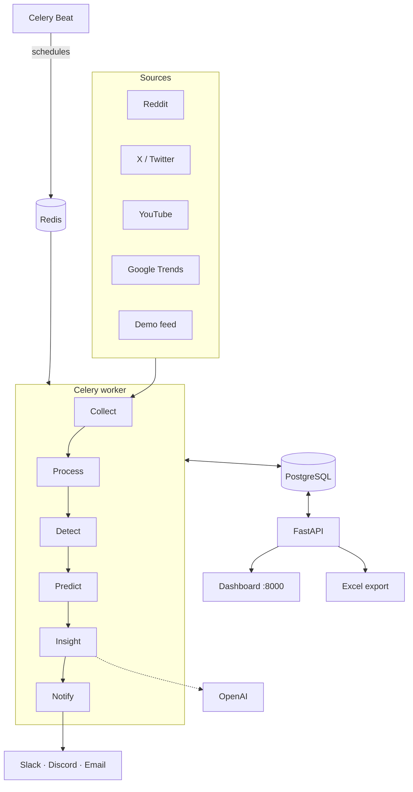

# Trend Intelligence Platform: project description

> An autonomous system that detects emerging social-media trends early, predicts which will go viral, turns
> them into ready-to-make content ideas, and alerts you, with a live dashboard and a full analytics export.

| | |
|---|---|
| **Repository** | github.com/SreyanBhattacharya/Trend-intelligence |
| **Status** | Working end to end · 38 automated tests · CI on every push |
| **Stack** | Python · PostgreSQL · Redis · Celery · spaCy · NumPy (+ optional Prophet, BERTopic) · OpenAI · FastAPI · vanilla JS/SVG · Docker Compose · GitHub Actions |
| **Runs with** | zero API keys (deterministic demo feed) or live Reddit, X, YouTube and Google Trends |
| **Other docs** | [RUNBOOK](RUNBOOK.md) · [LEARNING_GUIDE](LEARNING_GUIDE.md) · [DASHBOARD_GUIDE](DASHBOARD_GUIDE.md) · [architecture](architecture.md) |

---

## 1. Problem

Creators, marketers and brands win by posting about a topic **while it's rising**, not after it has peaked.
Doing that by hand means watching several platforms all day and guessing which spikes are real. Generic
"trending" lists show what is *already* big and aren't specific to your niche.

## 2. Solution

Trend Intelligence continuously:

1. **Collects** posts and engagement from Reddit, X, YouTube and Google Trends.
2. **Builds an hourly time series for every phrase** being discussed.
3. **Detects spikes:** phrases whose last 3 hours are statistically unusual compared with their own last 24 hours.
4. **Scores** each trend's strength (trend score) and likelihood of going viral (virality probability), plus
   momentum and an estimated lifespan.
5. **Generates content ideas** (format, hook, caption, hashtags) for strong trends with an LLM.
6. **Alerts** via Slack, Discord or email once a trend crosses both thresholds, at most once per day per trend.
7. **Shows everything** on a web dashboard and **exports all analytics** to one Excel workbook.

## 3. Features

| Area | Feature |
|---|---|
| Data collection | Reddit (PRAW), X API v2 (Tweepy), YouTube Data API v3 trending chart, Google Trends RSS, deterministic demo feed; per-source isolation; idempotent upserts |
| NLP | cleaning, spaCy POS filtering, consistent 2–3-word phrase extraction, hashtag normalisation |
| Detection | per-term hourly series; z-score + growth-ratio spike test; representative-phrase selection; sub-phrase, hashtag and context-fragment de-duplication; trend lifecycle (active → inactive after 48h) |
| Prediction | momentum, acceleration, volume, spread and novelty features → trend score, virality probability, lifespan; optional Prophet forecast blend; partial-hour correction |
| Insight | OpenAI JSON-mode content ideas with real example posts as context; template fallback |
| Alerts | Slack, Discord, email, console; thresholds + 24h cooldown; per-alert transactions |
| Orchestration | Celery worker + Beat over Redis; APScheduler alternative; run log with trigger, duration, status and summary |
| Dashboard | Overview, Trends (with detail drawer), Datasets, Pipeline, Alerts; on-demand runs; auto-refresh; responsive |
| Analytics | one-click Excel export: 10 sheets + native charts |
| Ops | Docker Compose (db, redis, migrate, worker, scheduler, web), idempotent migrations, health endpoint, config hot-reload via a bind mount |
| Quality | 38 tests (unit + Postgres integration + API), flake8, GitHub Actions CI + Docker build |

## 4. Architecture



**Code layout**

```
agents/            the six pipeline stages (one class each)
ai_models/         trend_model.py (spike detection) · prediction_model.py (scoring)
alerts/            slack_service.py · discord_service.py · email_service.py
analytics/         export.py (Excel workbook)
api/               server.py (FastAPI: JSON API, run trigger, export, serves the dashboard)
config/            config.yaml + loader (defaults, .env, placeholder handling)
data_processing/   cleaning_pipeline.py · keyword_extraction.py
database/          db_connection.py · schema.sql (idempotent; also upgrades old databases)
services/          reddit_api · twitter_api · youtube_api · google_trends_api · demo_source · scraper_service
web/               index.html (dashboard; one file, no build step)
workflows/         pipeline.py (Celery app, schedule, run logging) · scheduler.py (APScheduler)
tests/             unit, integration and API tests
main.py            CLI: init-db · collect · run-once · schedule · report · web · export
```

## 5. Data model

| Table | Purpose |
|---|---|
| `posts` | raw posts, unique per `(platform, post_id)`, with engagement, `keywords[]` and a `processed` flag |
| `keywords` | lifetime totals per term |
| `keyword_mentions` | **hourly** mentions + engagement per term per platform (the detection input) |
| `trends` | one row per trend: key, source, platforms, z-score, related posts, active flag |
| `engagement_metrics` | hourly series per trend (the prediction input) |
| `trend_predictions` | score history; view `latest_trend_predictions` |
| `content_ideas` | generated ideas |
| `alerts` | alert log (drives the cooldown) |
| `pipeline_runs` | every collection/pipeline run with trigger, status, duration and JSON summary |

## 6. Scoring definitions

| Metric | Range | Meaning | How |
|---|---|---|---|
| Spike z-score | any | how unusual the current 3h window is for this phrase | (current − baseline mean) / (baseline std + 1) |
| Growth ratio | ≥ 0 | times the usual 3h volume | (current + 1) / (baseline mean + 1) |
| Momentum | any | hourly log-growth over 6h | slope of ln(1 + mentions) |
| Trend score | 0–100 | strength now | 35% growth · 25% volume · 25% novelty · 15% cross-platform reach |
| Virality probability | 0–100 | chance-like score that it keeps growing to viral levels | logistic over momentum, acceleration, volume, spread, novelty |
| Lifespan | 1–14 days | rough expected life | from momentum, spread and deceleration |
| Engagement score | 0–100 | per-post engagement | log-scaled (likes + 2·comments + 3·shares), per view when views are known |

Full formulas: [LEARNING_GUIDE §5](LEARNING_GUIDE.md#5-end-to-end-what-happens-in-one-run).

## 7. API

| Method & path | Returns |
|---|---|
| `GET /` | the dashboard |
| `GET /api/health` | database connectivity |
| `GET /api/overview` | KPIs, platform mix, sources, channels, thresholds, last run |
| `GET /api/trends?limit&include_inactive` | trends + latest prediction, 27h series, platform split, latest idea |
| `GET /api/trends/{id}` | detail: series, prediction history, top posts, ideas, alerts |
| `GET /api/posts?platform&q&limit&offset` | paged, searchable posts |
| `GET /api/keywords?limit&exclude_trends` | rising terms vs. baseline |
| `GET /api/activity?hours` | posts per hour per platform |
| `GET /api/runs?limit` | run log |
| `GET /api/alerts` · `GET /api/ideas` | alert log · content ideas |
| `GET /api/config` | effective settings + schedule |
| `POST /api/run {task: all\|collect\|pipeline}` · `GET /api/run` | start a run in the background · is one running? |
| `GET /api/export.xlsx` | the full analytics workbook |

Interactive docs: `http://localhost:8000/docs`.

## 8. Configuration

* `.env`: API keys, webhooks, SMTP, `DEMO_MODE`, `OPENAI_MODEL`, database/Redis URLs. See
  [RUNBOOK §4](RUNBOOK.md#4-adding-api-keys-env).
* `config/config.yaml`: sources, detection windows and sensitivity, alert/insight thresholds, cooldown and
  schedules. See [RUNBOOK §5](RUNBOOK.md#5-tuning-behaviour-configconfigyaml).

## 9. Current limitations

* The virality model is **hand-weighted**, not trained, because there are no labelled outcomes yet.
* Detection is **global**: there is no per-user niche or topic focus yet.
* Content ideas are **one-liners** (format, hook, caption, hashtags), not full video plans.
* English only; one region per source.
* X recent search requires a paid API tier; TikTok and Instagram aren't connected.
* No authentication on the dashboard (intended for local use).
* Raw posts are kept forever (no retention policy).

---

## 10. Roadmap: future enhancements

Effort: **S** = about a day · **M** = 2–5 days · **L** = 1–2 weeks.

### 10.1 Niche filter & topic search (M–L) — highest-value next step

**Goal:** a user enters a niche (for example *"skincare"*, *"indie games"*, *"personal finance India"*) and sees
trends **inside that niche**, gets alerts only for it, and collection focuses on it.

**User experience**
* The dashboard gets a **niche selector** in the top bar (*All · Skincare · Indie games · + New niche*).
  Every page filters to the selected niche.
* A **search box** on the Trends page: type a topic → see matching trends, rising phrases and top posts about it,
  even ones below the alert threshold.
* **Niche settings:** keywords, excluded words, subreddits, YouTube category, region, and alert channel per
  niche.

**Design**
1. **Schema**
   ```sql
   CREATE TABLE niches (id SERIAL PRIMARY KEY, name TEXT UNIQUE, keywords TEXT[], exclude TEXT[],
                        subreddits TEXT[], youtube_category INT, region VARCHAR(5),
                        alert_channels TEXT[], created_at TIMESTAMPTZ DEFAULT now());
   CREATE TABLE post_niches (post_id INT REFERENCES posts(id) ON DELETE CASCADE,
                             niche_id INT REFERENCES niches(id) ON DELETE CASCADE,
                             score REAL, PRIMARY KEY (post_id, niche_id));
   ALTER TABLE trends ADD COLUMN niche_id INT REFERENCES niches(id);   -- NULL = global
   ```
2. **Collection:** per niche, search its keywords (X query, Reddit `subreddit.search`, YouTube `search.list` with
   `q=` + `order=date`) and its subreddits. This is much more targeted than global charts.
3. **Classification (which posts belong to a niche):**
   * v1 *keyword match:* any niche keyword or synonym in the post's `keywords[]` (fast; a GIN-indexed `&&` query).
   * v2 *semantic match:* embed posts and a niche description with a sentence-embedding model (e.g.
     `all-MiniLM-L6-v2`, or an embeddings API). Cosine similarity ≥ threshold → member. Store vectors with
     **pgvector**. This catches posts that never use the exact keyword.
   * *Query expansion:* suggest related keywords from co-occurring phrases in matched posts (for example
     skincare → "niacinamide", "slugging").
4. **Detection per niche:** run the same spike detection on `keyword_mentions` restricted to that niche's posts
   (add `niche_id` to `keyword_mentions`, or compute from `post_niches`). Baselines are then *niche-relative*:
   "niacinamide" can trend inside skincare even if it's tiny globally.
5. **API:** `GET/POST /api/niches`, a `niche_id` parameter on every list endpoint, and
   `GET /api/search?q=` returning trends, phrases and posts ranked by relevance × momentum.
6. **Alerts:** per-niche thresholds and channels (e.g. skincare → #beauty-team Slack).

**Done when:** creating a niche makes the dashboard show only that niche's trends within one pipeline cycle; search
returns relevant trends for a free-text topic; and tests cover classification and niche-scoped detection.

### 10.2 Full video content packages (M)

**Goal:** turn each strong trend into something a creator can shoot today: **title, hook, video structure,
caption, hashtags, and a thumbnail idea.**

**Output structure** (stored as `JSONB` in `content_ideas.package`):
```json
{
  "platform": "YouTube Shorts",
  "title": "I tried AI voice clones for a week — here's what happened",
  "hook": { "line": "This voice isn't mine. And you couldn't tell.", "visual": "Split screen: me vs. my clone talking" },
  "angle": "Personal experiment + honest verdict",
  "target_length_sec": 45,
  "structure": [
    { "t": "0-3s",   "beat": "Hook",    "script": "This voice isn't mine…",          "on_screen_text": "AI VOICE CLONE?", "shot": "close-up, split screen" },
    { "t": "3-12s",  "beat": "Context", "script": "Everyone's using voice clones…",  "on_screen_text": "Why it's trending", "shot": "screen recording of tool" },
    { "t": "12-35s", "beat": "Payoff",  "script": "3 things I learned…",            "on_screen_text": "1 · 2 · 3",         "shot": "talking head + B-roll" },
    { "t": "35-45s", "beat": "CTA",     "script": "Would you use one? Comment…",     "on_screen_text": "Comment YES/NO",    "shot": "face to camera" }
  ],
  "caption": "Everyone's suddenly cloning their voice. I tested it so you don't have to. 🎙️",
  "hashtags": ["#AIVoice", "#VoiceClone", "#TechTok"],
  "thumbnail": { "text": "IS THIS ME?", "idea": "Shocked face + waveform graphic" },
  "cta": "Ask viewers which tool to test next",
  "sources": ["post ids the idea was grounded in"],
  "variants": [ { "platform": "X thread", "outline": ["…"] }, { "platform": "Instagram carousel", "slides": ["…"] } ]
}
```

**Design**
1. **Prompt:** the system prompt defines the JSON schema above (use OpenAI **structured outputs** with a JSON
   schema, so the shape is guaranteed). The user prompt includes the trend, the detection signal, the top 5–10
   posts (titles and engagement), the niche, and the target platform and length.
2. **Platform presets:** Shorts/Reels/TikTok (15–60s, 4–5 beats), YouTube long form (6–10 min, chapters),
   X thread (5–8 posts), carousel (6–10 slides).
3. **Template fallback:** keep a rules-based package (hook formulas such as *curiosity gap*, *contrarian take*,
   *"I tried X"* or *"3 things about X"*, plus a 4-beat structure) so the feature works without an API key.
4. **Hook library:** store proven hook patterns; ask the model for 3 alternatives and score them (length,
   specificity, curiosity).
5. **Dashboard:** an idea card expands into a **storyboard view** (beats as a timeline with script, on-screen
   text and shot), with buttons to **Copy script**, **Copy caption** and **Download as .md / .pdf**.
6. **Feedback loop:** 👍/👎 and "posted it" per idea; later, record the published post's performance to learn
   which hooks and structures work per niche.

### 10.3 Learn the virality model from outcomes (M)
Label each trend after 48–72h (did mentions or engagement grow ≥ N×? did it reach X platforms?). Fit a logistic
regression or gradient-boosted model on the existing features. Report precision/recall of alerts and calibrate
probabilities (reliability curve). The `features` dict is already produced by `predict_virality()`.

### 10.4 More sources (M each)
TikTok (Research API / Creative Center), Instagram (Graph API hashtag search), news RSS (Google News per niche),
Hacker News / Product Hunt for tech niches, YouTube `search.list` for niche queries, regional Google Trends
(multiple `geo` values, e.g. IN + US).

### 10.5 Live updates & UX (S–M)
Server-Sent Events so the dashboard updates the moment a run finishes; a trend **watchlist** (pin trends); a
dark mode; date-range filters; shareable trend pages; "compare two trends" charts.

### 10.6 Accounts & multi-user (M)
Login (OAuth or magic link), per-user niches, alert preferences and saved ideas; dashboard authentication before
any public deployment.

### 10.7 Scale & reliability (M–L)
Data retention (keep hourly rollups and drop raw posts after 30 days), table partitioning or TimescaleDB, retries
with exponential backoff and per-source rate-limit handling, a dead-letter queue, Celery Flower / Prometheus +
Grafana monitoring, structured JSON logs, and Sentry error tracking.

### 10.8 Deployment (S–M)
Deploy to Render, Railway or Fly.io with managed Postgres and Redis; secrets in the platform's secret store; a CD
step in GitHub Actions after tests pass; a custom domain with HTTPS.

### 10.9 Smarter detection (M)
Multilingual NLP, entity linking (merge "GPT-5" / "gpt5" / "chat gpt 5"), sentiment per trend (rising
*negative* chatter is a different opportunity), seasonality-aware baselines (weekday/weekend), and embeddings
clustering by default.

### 10.10 Publishing integrations (L)
Schedule a post from an idea (Buffer or native APIs), then pull its performance back to close the feedback loop
from §10.2.

**Suggested order:** 10.1 niche search → 10.2 video packages → 10.3 learned model → 10.8 deploy → the rest.
