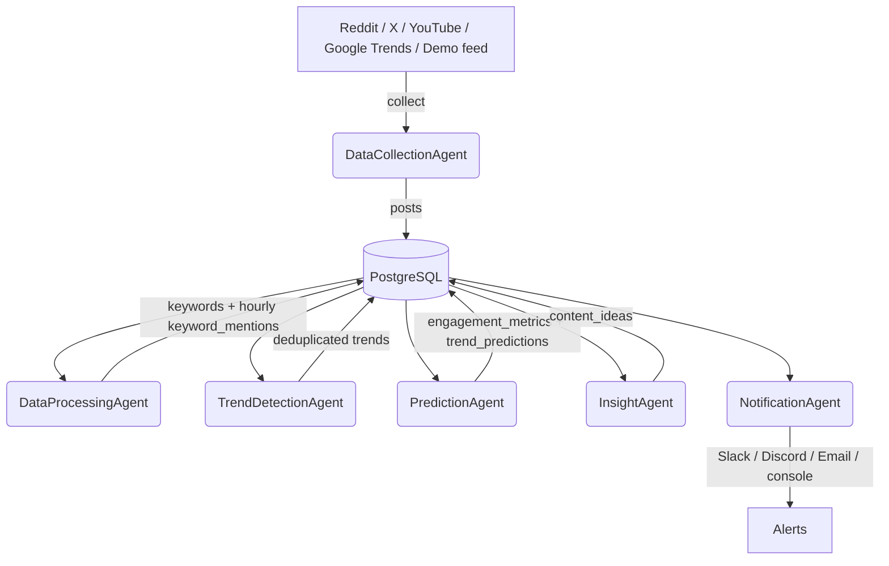

# System Architecture

## Overview
The platform is a pipeline of agents that share state through PostgreSQL. Collection jobs and the core pipeline are
scheduled by Celery Beat (Docker) or APScheduler (`python main.py schedule`). Both call the same functions in
`workflows/pipeline.py`.

## Data model
| Table | Purpose |
|---|---|
| `posts` | Raw posts, unique per `(platform, post_id)`. Stores extracted `keywords` and an `engagement_score`. |
| `keywords` | Lifetime totals per term (reporting). |
| `keyword_mentions` | **Hourly** mentions and engagement per `(term, hour, platform)`. This is the time series detection runs on. |
| `trends` | One row per trend (`trend_key` unique), with source, platforms, z-score, related posts and active flag. |
| `engagement_metrics` | Hourly series per trend, one row per `(trend_id, hour)`. |
| `trend_predictions` | Score history. The `latest_trend_predictions` view gives the newest row per trend. |
| `content_ideas`, `alerts` | Generated ideas and the alert log (used for the 24h cooldown). |
| `pipeline_runs` | Every collection / pipeline run: trigger, status, duration and JSON summary. |

The **dashboard** (`web/index.html`) and **JSON API** (`api/server.py`, FastAPI) read these tables. The **Excel
export** (`analytics/export.py`) writes all of them into one workbook. See [DASHBOARD_GUIDE.md](DASHBOARD_GUIDE.md).

`database/schema.sql` is idempotent and also upgrades databases created from the original schema
(`python main.py init-db`).

## Detection
1. For each term busy enough in the **current window** (default 3h), load its hourly counts over the baseline
   (default 24h).
2. Split the baseline into windows of the same size. A term spikes if `z = (current − mean) / (std + 1)` is at least
   2.5, or if `current / mean` is at least 3×.
3. Each flagged term is replaced by its **representative**: the longest phrase that contains its words and carries
   ≥40% of its volume ("voice" → "ai voice clones").
4. Duplicates are removed: sub-phrases, hashtag forms ("aivoiceclones"), and **context fragments**, meaning terms
   where ≥80% of their posts also mention a larger trend ("tested solar balcony").
5. Trends are upserted by key, so re-detection refreshes a trend instead of duplicating it. Trends not seen for 48h
   are deactivated.

Google Trends searches become trends directly (source `google_trends`). BERTopic clusters can be enabled with
`detection.topic_clustering: true`.

## Prediction
From the trend's zero-filled hourly series:
* **momentum**: slope of `log(1 + mentions)` over the last 6h
* **acceleration**: change in that slope (clipped)
* **volume**: `log(1 + mentions in the last 3h)`
* **spread**: number of platforms
* **surprise**: the current window's z-score against the trend's own history

The virality probability is `sigmoid(w · features)` × 100. The trend score is a 0–100 blend of growth, size,
novelty and reach. With Prophet installed and at least 12 hours of history, the forecast's expected 24h growth is
averaged into momentum.

## Demo feed
`services/demo_source.py` generates posts deterministically per hour, so repeated collection is idempotent. Two
emerging-topic slots run on 12-hour cycles, offset by 6 hours. Each topic grows about 1.55× per hour and spreads from
Reddit to X to YouTube, against steady background chatter.
