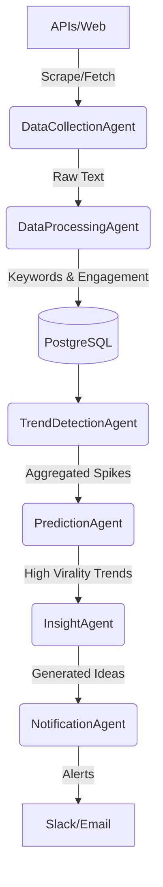

# System Architecture

## Overview
The Trend Intelligence Platform operates on a multi-agent orchestrated pipeline.

## Architectural Layers
1. **Data Sources**: External APIs (Twitter, Reddit, YouTube, Google Trends) and web scraping endpoints.
2. **Workers/Agents**:
   - `DataCollectionAgent`: Fetching / scraping logic.
   - `DataProcessingAgent`: Entity extraction, structural normalization.
   - `TrendDetectionAgent`: Topic clustering, spike detection.
   - `PredictionAgent`: Time-series engagement modeling.
   - `InsightAgent`: LLM generation.
   - `NotificationAgent`: Slack/Email delivery.
3. **Orchestration**: Celery/Redis manages the distributed queues and background schedules (`Celery Beat`).
4. **Data Persistence**: PostgreSQL stores the relations: `posts` -> `trends` -> `engagement_metrics` -> `predictions`.

## Data Flow

